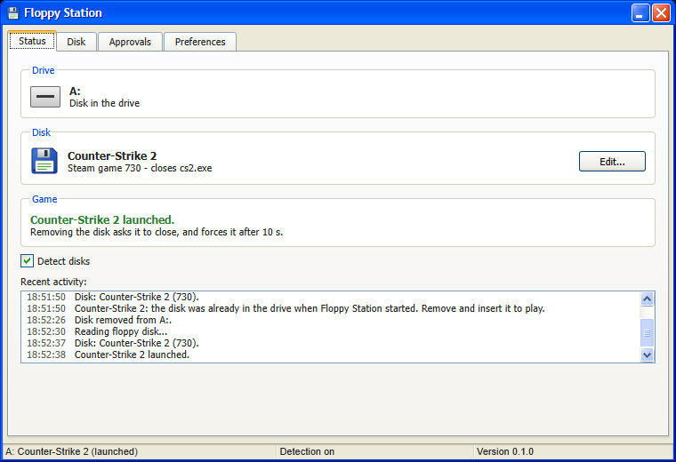
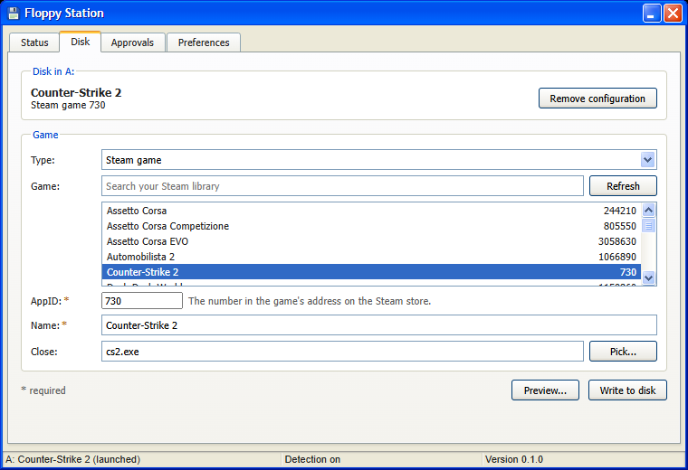

# Floppy Station

Turn floppy disks into game cartridges for your PC. Insert a disk and its
game starts; take it out and the game closes.

The game isn't on the disk. It stays installed on your PC as usual: the disk
only holds a tiny file that says which game it stands for. Any 3.5" disk and
a USB floppy drive will do, and each disk can have its own game.

Floppy Station runs in the background, in the system tray, and stays out of
the way: no administrator rights, no watching what you do, and it only
touches the drive you choose.



## Requirements

- Windows 10 or 11.
- A USB floppy drive and formatted 3.5" floppy disks.
- Microsoft Edge WebView2, which Windows 11 and up-to-date Windows 10 already
  have. The installer downloads it if it's missing.

## Install

Download `Floppy-Station_<version>_x64-setup.exe` from the
[releases page](https://github.com/markjunior2045/FloppyStation/releases)
and run it. It installs for your user only, in
`%LOCALAPPDATA%\Floppy Station`, and doesn't ask for administrator rights.

The first time it runs, Floppy Station opens a welcome window. After that it
starts in the tray: click the floppy icon to open the window.

## Getting started

1. **Pick your drive.** The welcome window (or the **Preferences** tab) lists
   the removable drives. Floppy drives are usually `A:`.
2. **Insert a blank disk.** A small box says *Reading floppy disk...*, then
   *This disk has no game yet*. Click **Configure**.
3. **Choose the game** in the **Disk** tab:
   - **Steam game:** pick it from your installed games, or type its AppID
     (the number in the game's address on the Steam store).
   - **Program:** any `.exe` on your PC, with optional arguments.
4. **Choose what to close** when the disk is removed (**Close**). Click
   **Pick...** to choose from the programs open right now: start the game
   first, then pick it. For a Program you can leave it empty: Floppy Station
   then closes the program it started. For a Steam game, leave it empty only
   if you don't want the game closed.
5. Click **Write to disk**. Take the disk out and insert it again: the game
   starts.



To change or remove a disk's game, insert it and use the **Disk** tab.

## How it behaves

- **Inserting a disk** reads it and starts its game. It takes about 6 to 8
  seconds, mostly the drive reading the disk.
- **Removing the disk** closes the game it started. By default it asks the
  game to close and forces it after 10 seconds; you can change this, or leave
  games open, in **Preferences**.
- **Only games it started are closed.** A game you opened yourself is never
  touched, and a disk already in the drive when Floppy Station starts doesn't
  start its game: take it out and insert it again.
- **Several games** can be open at once; removing a disk closes only its own
  game.
- **Unplugging the drive** counts as removing the disk, unless you choose
  otherwise in **Preferences**.
- When a disk goes in, Floppy Station has Windows read it again from
  scratch, because some USB drives don't tell Windows a disk was swapped.
  File Explorer windows showing the drive close at that moment.

### Programs need your approval

A disk set up as a **Program** can start any program on the PC, with any
arguments. So that a disk from someone else can't run things on your PC,
Floppy Station only starts programs you approved:

- A disk you write with Floppy Station is approved on this PC automatically.
- Any other program disk (made on another PC, or edited by hand) does
  nothing until you approve it: click **Review** and check what it would run.
- Changing anything in a disk's file makes it need approval again.
- The **Approvals** tab lists the approved programs and revokes them.

Steam games don't need approval: they can only start a game by its AppID.

### Quiet waiting

Checking an empty floppy drive for a disk makes it click. By default
Floppy Station instead waits for a disk in a way that makes the drive click
only about every 20 seconds, while still noticing a disk the moment it goes
in. While it waits, the drive's light stays on (the motor doesn't run), and
opening the empty drive in File Explorer waits until a disk is inserted.

You can turn this off in **Preferences** (*Wait quietly for a disk when the
drive is empty*); the drive is then checked at the interval set there, with a
click each time.

### Tray menu

The tray icon's menu shows what's going on, opens the window, turns disk
detection on and off, and exits. Closing the window keeps Floppy Station
running in the tray; only **Exit** stops it. Games stay open when it exits.

### Languages

Floppy Station speaks English, Portuguese and Spanish. It follows the Windows
display language by default; pick another one in **Preferences**.

## The disk file

Floppy Station writes `floppy-station.toml` at the root of the disk, next to
any other files, which it never deletes. It's plain text:

```toml
version = 1

[game]
name = "Counter-Strike 2"
kind = "steam"
steam_app_id = 730
process = "cs2.exe"
```

```toml
version = 1

[game]
name = "Doom"
kind = "exe"
path = 'C:\Games\Doom\doom.exe'
args = ["-fullscreen"]
```

| Field | Meaning |
|---|---|
| `name` | Name shown in the app, up to 100 characters. |
| `kind` | `steam` or `exe` (shown as *Program*). |
| `steam_app_id` | For `steam`: the game's AppID. |
| `path` | For `exe`: full path of the program. Specific to the PC it was set up on. |
| `args` | For `exe`, optional: arguments for the program. |
| `process` | Optional: name of the program to close when the disk is removed, such as `cs2.exe`. |

## Labels for your disks

To make your disks look the part, use
[Floppy Station Sticker Creator](https://markjunior2045.github.io/FloppyStationStickerCreator/)
([source](https://github.com/markjunior2045/FloppyStationStickerCreator)), a
companion website for designing game labels for 3.5" disks, in the style of
old game labels. It prints them at their exact size (A4 PDF with cut marks,
or PNG) and runs entirely in your browser.

## What Floppy Station touches

- **Only the drive you choose.** The drive list only asks Windows which
  drives are removable, without reading them.
- **No process monitoring.** It looks at running programs only when closing
  a game (to find the one it started) and when you open the **Pick...** list.
- **No administrator rights,** and it never starts programs that need them,
  since it couldn't close them.
- **Its files:** settings and approved programs in `%APPDATA%\floppy-station`;
  logs in `%LOCALAPPDATA%\floppy-station\logs`. Starting with Windows uses
  your user's `Run` registry key.

## Known limitations

- The drive is identified by its letter. If plugging it into another USB
  port changes the letter, choose the new one in **Preferences**.
- Right after the drive is plugged in, it takes about 20 seconds before
  Floppy Station can use it.
- A disk configured on one PC may point to a program that isn't on another.
- Floppy Station doesn't know whether a game is still running: it only
  checks when the disk is removed.

## Troubleshooting

**Preferences → Open log folder** opens the folder with Floppy Station's
log, `floppy-station.log`. Include it when reporting a problem.

## Building from source

You need [Rust](https://rustup.rs/) (stable) and
[Node.js](https://nodejs.org/) with npm.

```powershell
cd app
npm install
npx tauri build            # app and installer
npx tauri build --no-bundle  # app only, in target\release
npm run tauri dev          # run in development
```

The repository is a Cargo workspace:

- `core/`: the library with all the logic (drive detection, disk files,
  launching and closing games, settings).
- `app/`: the Tauri app (Rust backend in `app/src-tauri`, Svelte frontend in
  `app/src`).
- `cli/`: a console tool for diagnostics and testing with real hardware.
  Run `cargo run -p floppy-station-cli -- --help` to see its commands.

```powershell
cargo test --workspace
```

## License

[MIT](LICENSE)
